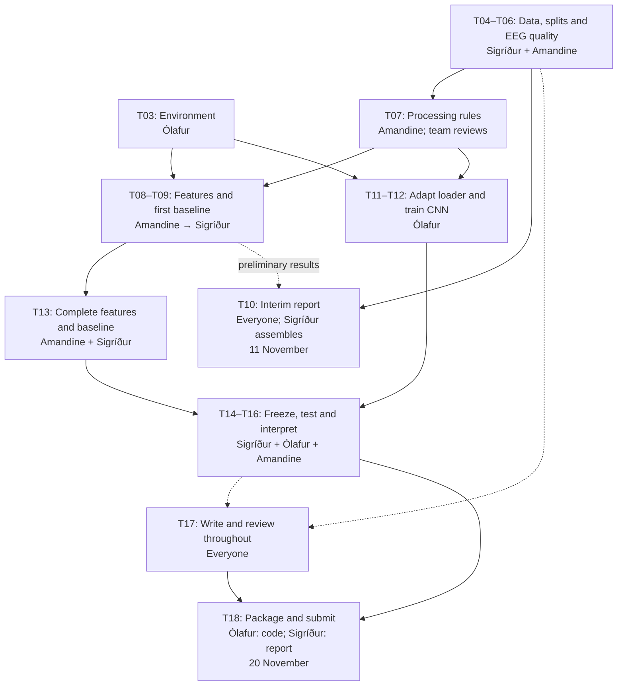

# Predicting brain age in children — project plan
 
**Interim: 11 November · Final: 20 November**

The group has already met and discussed project possibilities. This schedule sets out the next steps; no additional planning meeting is needed.

## Goal

Compare a simple EEG feature-based regression model with one small CNN for predicting children's chronological age. Use the supplied preprocessed data and keep extra experiments optional.

## Who does what?

| Person | Main responsibility | Writes about |
|---|---|---|
| Sigríður  | Split audit, baseline regression, model comparison, interpretation and report coordination | Dataset, baseline, evaluation and interpretation |
| Amandine | EEG quality, segment rules, feature extraction and associated figures | Signal processing and features |
| Ólafur | Environment, supplied loader adaptation, CNN, training curves, code reproducibility and final code packaging | CNN and training methods |

Everyone writes their own methods/results, reviews another person's work, and helps finish the report. Sigríður coordinates the report; everyone contributes to it.

## Task list

Already completed: **Ólafur created the GitHub repository and arranged GPU access; the group has met and discussed the project.**

Update status from **To do → In progress → Review → Done**. The owner is responsible for delivering the output; others can help. Dates below are working targets unless marked as submission deadlines.

| ID | Task | Owner | Partner / Reviewer | Depends on | Target | Done when | Status |
|---|---|---|---|---|---|---|---|
| T01 | Check submission details and instructor requirements | Sigríður | — | — | 7 Nov | Interim length, cutoff times and required instructor contact are recorded | Done |
| T02 | Record agreed roles and available compute | Sigríður, with Amandine and Ólafur | Everyone | — | 7 Nov | Roles, GitHub and GPU arrangements appear in this plan | Done |
| T03 | Finish environment setup and start experiment/AI logs | Ólafur | Sigríður | — | 7 Nov | Everyone has repository access; a small GPU run works; environment and logs are saved | To do |
| T04 | Audit labels and recording files | Sigríður | x | — | 7 Nov | File/label matching, shapes, durations and anomalies are documented | Done |
| T05 | Verify training/validation/test splits | Sigríður | x | T04 | 7 Nov | No child crosses splits; identity assumptions and split distributions are recorded | Done |
| T06 | Inspect EEG quality and produce example figures | Amandine | Sigríður | T04 | 8 Nov | Training EEG examples show quality issues, clipping, flatlines and padding checks | To do |
| T07 | Document segment and processing rules | Amandine; Sigríður and Ólafur review | Sigríður + Ólafur | T05, T06 | 8 Nov | Channels, windows, quality rules, scaling and prediction aggregation are written down | To do |
| T08 | Extract initial Hjorth/band-power features | Amandine | Sigríður | T03, T07 | 9 Nov | Small feature table contains valid values, recording IDs and feature definitions | To do |
| T09 | Run initial regression baselines | Sigríður | Ólafur | T08 | 10 Nov | Median-age and simple feature-regression validation results are saved | To do |
| T10 | Assemble, review and submit interim report | Amandine  assembles; everyone writes/reviews their contribution | Everyone | T01, T04; T09 if available | **11 Nov deadline; review 10 Nov** | Contributions are combined, checked by everyone and submitted | To do |
| T11 | Check and adapt supplied dataloader | Ólafur | Amandine | T03, T07 | 10 Nov | Batch shapes/labels are correct; training crops and fixed evaluation windows work | To do |
| T12 | Train compact CNN and save learning curves | Ólafur | Amandine | T11 | 15 Nov | Small-run checks pass; settings, curves and best validation checkpoint are saved | To do |
| T13 | Complete feature pipeline and baseline | Amandine: features/figures; Sigríður: regression | Ólafur | T09 | 15 Nov | Full feature pipeline, figures and baseline validation results are saved | To do |
| T14 | Select and freeze model settings | Sigríður: baseline; Ólafur: CNN; Amandine reviews processing | Amandine | T12, T13 | 16 Nov | Model, processing and aggregation settings are selected using validation only | To do |
| T15 | Run final held-out comparison |Ólafur supplies CNN predictions/metrics | Amandine | T14 | 16 Nov | Recording-level test predictions and a shared comparison table are saved | To do |
| T16 | Interpret errors and produce comparison figures | Sigríður; Amandine supports signal interpretation | Ólafur | T15 | 18 Nov | Predicted-age and age/error plots are saved with observations and limitations | To do |
| T17 | Write and review report sections throughout | Everyone | Everyone | Starts after T04; final results from T16 | 19 Nov | Each person has written their sections and reviewed another person's work | To do |
| T18 | Verify reproducibility, package and submit | Ólafur: code/package; Sigríður: report/submission; everyone: review | Everyone | T16, T17 | **20 Nov deadline; package 19 Nov** | Key results reproduce; reviewed PDF, code and required documentation are packaged and submitted | To do |

**T10 assembly means combining everyone's supplied contributions, checking length and consistency, and circulating for review. Each person writes their own part. Submit on time even if preliminary model results are incomplete.**

## Dependency diagram

Solid arrows show prerequisites. Dotted arrows show useful input or work that can start early. Setup and data checks run in parallel; feature/baseline and CNN work then run in parallel.

## Dates to work towards

| Date | Sigríður | Amandine | Ólafur |
|---|---|---|---|
| 6–7 Nov | Audit labels and splits | Inspect EEG quality; document segment rules | Finish environment setup and verify GPU run |
| 8–10 Nov | Fit first baseline once features arrive; coordinate interim | Deliver first features and EEG/feature figures | Adapt supplied loader; run a small CNN check |
| **11 Nov** | **Submit interim after everyone's review** | Contribute preprocessing summary and figures | Contribute setup/CNN progress |
| 12–15 Nov | Complete baseline; prepare comparison code; write own sections | Finish features and figures; write own sections | Train/select CNN; save curves; write own sections |
| 16 Nov | Freeze baseline; coordinate final test comparison | Check feature pipeline and help review results | Freeze CNN; generate final test predictions and metrics |
| 17–19 Nov | Interpret results; integrate and review report | Review signal/feature results and report | Check reproducibility; prepare final code package; review report |
| **20 Nov** | **Submit final PDF and code after everyone's review** | Final submission check | Final submission check |

Submit the interim on time even if the CNN is still being developed. Confirm the interim length and submission cutoff times with the instructor.

## Rules that keep the results trustworthy

- Keep each child's recordings/windows in one split. Start with the supplied 825/103/104 split; confirm whether filenames uniquely identify children.
- Select features/settings using training and validation only. Fit scalers on training data; keep the test set for the frozen comparison.
- Start with 16-second segments as a proposal. Exclude padded/invalid regions; use fixed validation/test windows and average predictions per recording.
- Compare models on the same recordings and comparable EEG coverage. Main metric: **MAE in years per recording**; also save RMSE, R² and errors versus age.
- Save settings, seeds, predictions and experiment results. Check the small pipeline before full training.

## Report and teamwork

Use GitHub tasks/comments for progress updates and blockers; no extra team planning meeting is needed. Each person updates their own tasks. The assignment separately requires an instructor meeting at least once each week.

Final report: maximum 10 pages excluding appendices. Include introduction, prior work, AI statement, dataset/processing, methods, results, conclusions/future work, references, contributions and AI documentation. Everyone writes their own sections.

**AI policy:** document AI assistance, including plans, prompts, transcripts and marked artifacts. The assignment prohibits AI-written final-report components. This plan is an AI-assisted planning artifact.

